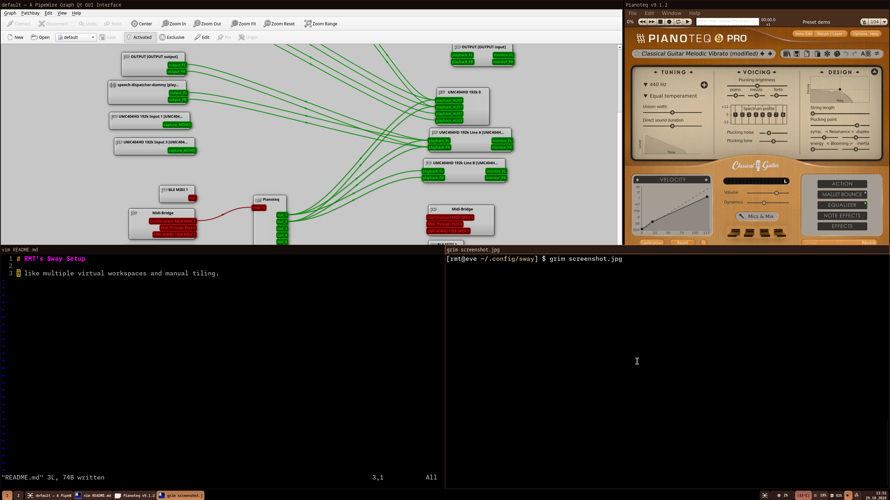

# RMT's Opinionated Wayland/Sway Setup

I like manual tiling using my full-size keyboard's numeric keypad.  I use the
keyboard to create new windows, and then I immediately place them where I want
them to be, typically in a corner, or centered on the screen.

This is obviously not so popular, and most X11 Window Managers and Wayland
Compositors do not support this.  Some require code changes, while others like
Sway (a wayland reimplementation of the i3 window manager), can be modified
with a bit of scripting.

Previously, I was able to achieve the same with Openbox on X11, but most
Wayland compositors didn't have built-in features and required patches.

Along the way, I discovered a couple of real bugs in Sway, which I was able to
fix, while keeping all the features in my external script.

## Behaviour

- `Super+Shift+KP_7` would move a window to the top-left corner, at exactly 50%
height and width.
- `Super+Shift+KP_7` would move a window to the top-left corner, at 70% height and width.
- `Super+KP_7` would cycle focus through all windows in the top-left corner.
- Similarly `MODS+KP_5` is the center, but at 70% and 90% instead of 50% and 70%.
- `MODS+KP-4` (left) aligns the window to the left edge, taking up 100% of vertical space.
- `MODS+KP-8` (up) aligns the window to the left edge, taking up 100% of horizontal space.
- Similar for the other keys.
- `Super+KP left/right/up/down` will also match the corner positions.
- New windows are made floating by default and are in the center zone but are not automatically resized until you place them.
- Any fixed size windows will be aligned with zone edges, and otherwise centered.
- Windows can be manually moved, but this does not alter their zone.. so if you want them in a particular zone, but location slightly adjusted, then move them to the zone that you want first.

## How it works

Move & Focus keybindings will run the `zone_helper` program (if you don't want
the nim version, there is a python version included).

## Upstream Bugfixes

Until they are merged, my sway patches can be found at https://github.com/rmt/sway/

- Patch 1 - fix the floating window restoration bug that has plagued Sway for ages.
- Patch 2 - respect xwayland XConfigureRequest mask and don't re-center windows on a resize

## Theme & Screenshot

I went with a bit of a coffee/earthy theme for a change.

